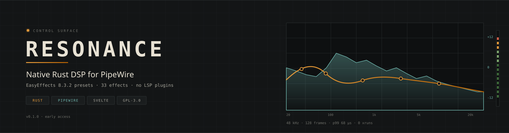
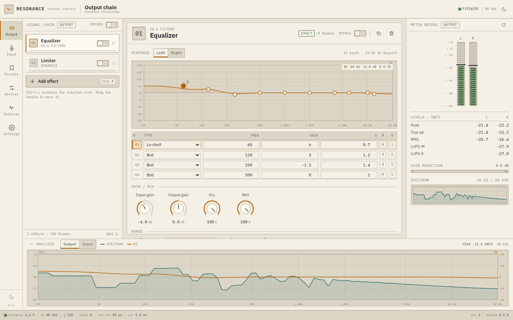
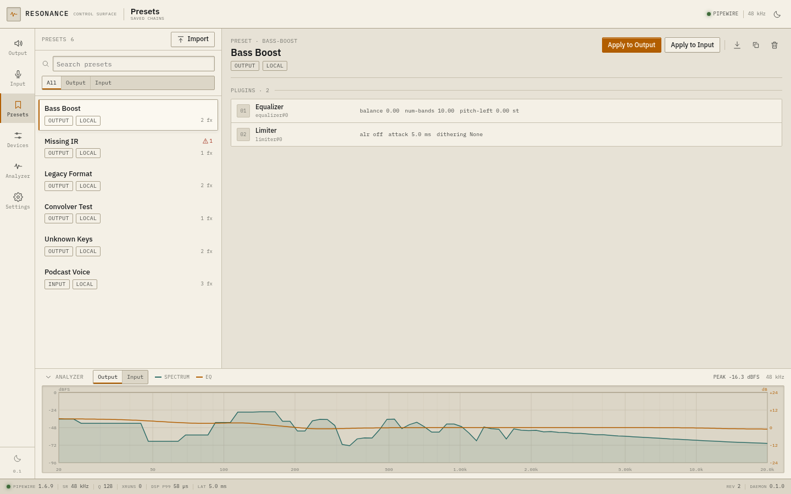
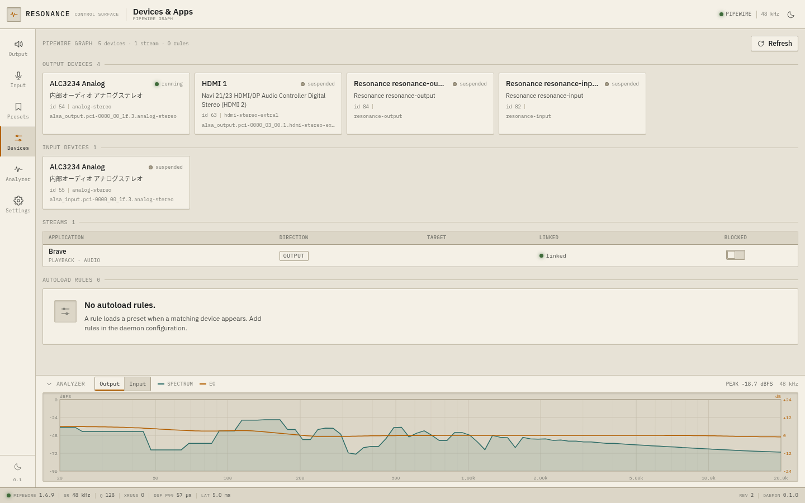
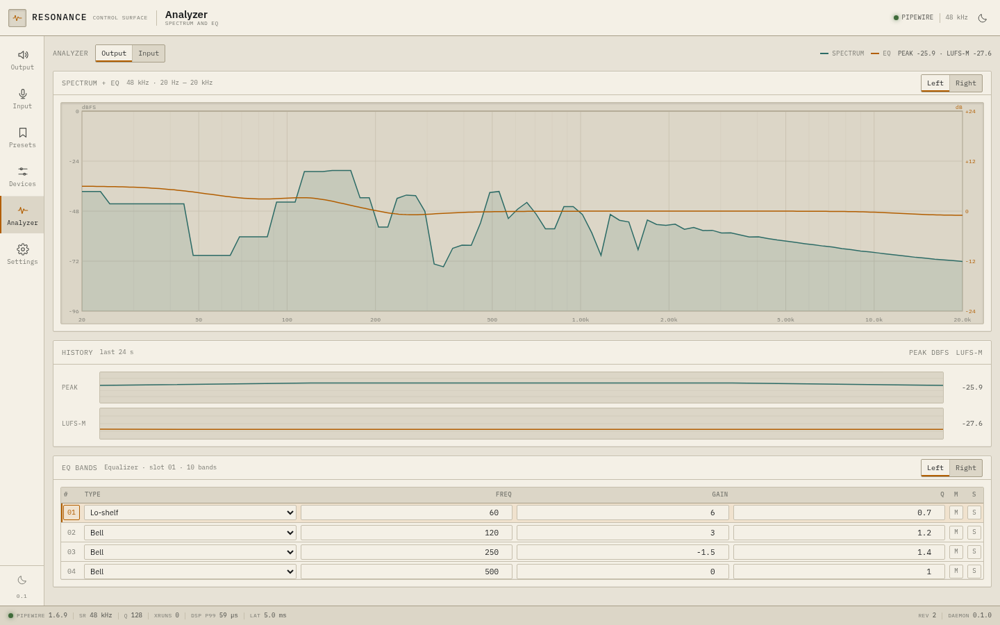
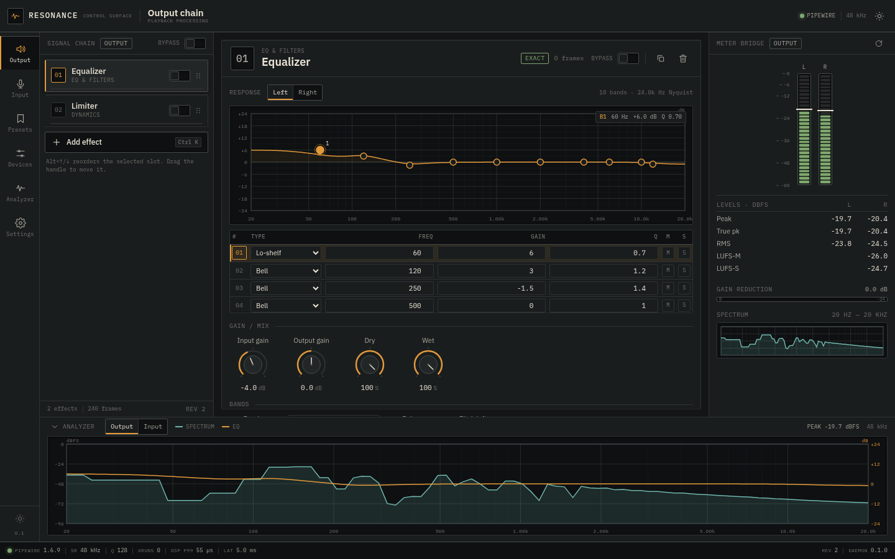
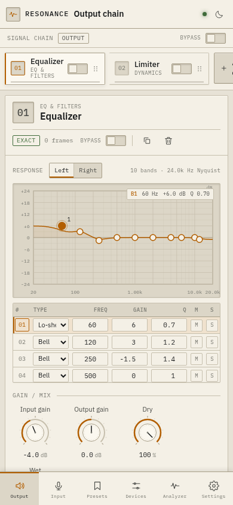
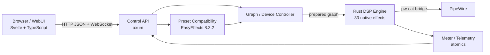

<div align="center">



<br />
<br />

<a href="https://github.com/souta-lab/resonance/releases"></a>
<a href="https://github.com/souta-lab/resonance/actions/workflows/ci.yml"></a>
<a href="LICENSE"></a>
<a href="https://www.rust-lang.org"></a>
<br />
<a href="https://pipewire.org"></a>
<a href="https://github.com/wwmm/easyeffects"></a>
<a href="#-why-resonance"></a>
<a href="#-testing"></a>
<br />
<a href="https://github.com/souta-lab/resonance/issues"></a>
<a href="https://github.com/souta-lab/resonance/stargazers"></a>

<h3>Studio-grade audio effects for PipeWire.<br />Written in Rust. Your EasyEffects presets just work.</h3>

<p>
  <code>33 native effects</code> · <code>real-time safe</code> · <code>browser control surface</code><br />
  <code>headless daemon</code> · <code>HTTP + WebSocket API</code> · <code>GPL-3.0</code>
</p>

<p>
  <a href="#-quick-start"><b>Quick start</b></a> ·
  <a href="#-screenshots"><b>Screenshots</b></a> ·
  <a href="#-features"><b>Features</b></a> ·
  <a href="#-effects"><b>Effects</b></a> ·
  <a href="#-architecture"><b>Architecture</b></a> ·
  <a href="#-performance"><b>Performance</b></a> ·
  <a href="#-roadmap"><b>Roadmap</b></a>
</p>

</div>

---

> [!WARNING]
> **Early access (v0.1.0).** The DSP, preset round-trip, API and UI are
> functional and tested, but this is not yet a drop-in replacement for
> EasyEffects. The PipeWire path currently uses a `pw-cat` bridge instead of a
> native `pw_filter`, and model-based effects are algorithmic substitutes.
> See [docs/roadmap.md](docs/roadmap.md) for the honest gap list.

## 📖 Table of contents

- [Why Resonance?](#-why-resonance)
- [Screenshots](#-screenshots)
- [Quick start](#-quick-start)
- [Features](#-features)
- [Effects](#-effects)
- [Architecture](#-architecture)
- [Performance](#-performance)
- [Control API](#-control-api)
- [CLI](#-cli)
- [Installation](#-installation)
- [Compatibility](#-compatibility)
- [Testing](#-testing)
- [Roadmap](#-roadmap)
- [Contributing](#-contributing)
- [License](#-license)

## 🎯 Why Resonance?

EasyEffects is excellent, but it is a Qt application built around LSP Plugins.
Resonance takes a different route: a small Rust daemon owns the audio graph, the
DSP is native Rust, and the UI is a static web app you can open from any browser
— or never open at all.

<table>
<tr>
<td width="33%" valign="top">

### 🧬 No LSP Plugins

Every effect is implemented in Rust. No LV2, LADSPA or VST binaries are loaded,
so a clean Linux install is enough. `resonance doctor` proves it.

</td>
<td width="33%" valign="top">

### 📦 Presets that carry over

Load EasyEffects 8.3.2 JSON, edit it, export it, and open it in EasyEffects
again. Unknown keys survive the round-trip. Legacy instance ids are normalized.

</td>
<td width="33%" valign="top">

### ⚡ Built for real time

Parameters are atomics. Graph swaps use a non-blocking hand-over. Retired
graphs are dropped off the audio thread. Bypass and dry/wet are ramped.

</td>
</tr>
<tr>
<td width="33%" valign="top">

### 🖥️ A control surface, not a desktop app

Svelte 5 + TypeScript, served by the daemon. Rack view, EQ editor, meters,
spectrum, presets, devices, diagnostics. Light "bench" and dark "night scope".

</td>
<td width="33%" valign="top">

### 🧰 Headless by default

`resonance daemon` keeps processing with no browser attached. The CLI can
import, apply, export and render WAV files offline.

</td>
<td width="33%" valign="top">

### 🔒 Local-first

Binds to `127.0.0.1`, issues a session token, checks `Origin`, and requires the
token for mutations and WebSocket subscriptions.

</td>
</tr>
</table>

## 📸 Screenshots

<div align="center">

| Output chain | Presets |
|:---:|:---:|
|  |  |
| **Devices & Apps** | **Analyzer** |
|  |  |
| **Night scope** | **Mobile** |
|  |  |

</div>

## 🚀 Quick start

### From source (recommended for now)

```bash
git clone https://github.com/souta-lab/resonance.git
cd resonance

# 1. Build the daemon and CLI
cargo build --release

# 2. Build the control surface
cd web && npm install && npm run build && cd ..

# 3. Run
./target/release/resonance daemon
```

Open **http://127.0.0.1:8737** and add an effect, or apply a preset.

The daemon creates two virtual sinks:

| Node | Use |
|---|---|
| `resonance-output` | Point a player at it to process playback |
| `resonance-input` | Select its monitor as a microphone to process capture |

### Try it without touching PipeWire

```bash
./target/release/resonance daemon --test-signal
```

The meters move, the DSP runs, and nothing is routed. Perfect for a first look.

### One command install

```bash
git clone https://github.com/souta-lab/resonance.git
cd resonance
./packaging/install.sh
systemctl --user enable --now resonance.service
```

Installs the binary to `~/.local/bin`, the web assets to
`~/.local/share/resonance/web`, and a systemd user unit.

## ✨ Features

<table>
<tr><td width="50%" valign="top">

**🎚️ 33 effects, all native**

Equalizer, Mid-Side EQ, Filter, Bass Enhancer, Bass Loudness, Loudness,
Compressor, Limiter, Maximizer, Expander, Gate, Multiband Compressor,
Multiband Gate, De-esser, Auto Gain, Convolver, Reverberation, Delay,
Crossfeed, Crosstalk Canceller, Stereo Tools, Exciter, Crystalizer, Crusher,
Pitch Shift, Autotune, Harmonizer, Speech Processor, Voice Suppressor,
Noise Reduction, Deep Noise Remover, Echo Canceller, Level Meter.

**🔌 EasyEffects 8.3.2 preset compatibility**

- Modern `equalizer#0` and legacy `equalizer` ids
- Multiple instances of the same effect
- `blocklist`, `plugins_order`, band objects
- Enum labels ↔ indices
- Unknown keys preserved losslessly
- Sorted, 4-space, newline-terminated export

</td><td width="50%" valign="top">

**⚡ Real-time safe graph**

- Lock-free parameter updates (`AtomicU32` per parameter)
- Graph hand-over with `try_lock`; no blocking on the audio thread
- Retired graphs dropped on the control thread
- Click-free bypass and dry/wet ramps
- 44.1 / 48 / 96 kHz, mono or stereo, block-size changes

**🖥️ Control surface**

- Rack view with drag-and-drop and `Alt+↑/↓` reorder
- Rotary knobs, segmented controls, physical switches
- EQ graph with draggable bands and a band table
- LED meters, true peak, LUFS-M/S, gain reduction
- Spectrum + EQ analyzer
- Preset import/export/apply, device and stream view
- Self-test and diagnostics

</td></tr>
</table>

## 🎛️ Effects

| Group | Effects | Highlights |
|---|---|---|
| **EQ & filters** | Equalizer, Mid-Side Equalizer, Filter, Bass Enhancer, Bass Loudness, Loudness | 32 bands/channel, RBJ biquads, M/S, 12/24/48 dB/oct Butterworth |
| **Dynamics** | Compressor, Limiter, Maximizer, Expander, Gate, Multiband Compressor, Multiband Gate, De-esser, Auto Gain | Soft knee, sidechain HPF/LPF, lookahead, LR4 crossovers |
| **Space & time** | Convolver, Reverberation, Delay, Crossfeed, Crosstalk Canceller, Stereo Tools | Partitioned FFT convolution, 8-line FDN, ping-pong delay |
| **Tone** | Exciter, Crystalizer, Crusher | Harmonic generation, transient HF, bit/sample-rate reduction |
| **Voice & pitch** | Pitch Shift, Autotune, Harmonizer, Speech Processor, Voice Suppressor | Granular shifter, YIN detection, scale quantisation |
| **Noise & echo** | Noise Reduction, Deep Noise Remover, Echo Canceller | STFT spectral subtraction, Wiener gate, NLMS AEC |
| **Measurement** | Level Meter | Peak, true peak, RMS, LUFS |

The full parameter matrix, compatibility level and known gaps live in
[docs/compatibility-matrix.md](docs/compatibility-matrix.md).

## 🏗️ Architecture



The audio thread never allocates, locks, logs or performs IO. Structural
changes are prepared on the control thread and handed over through a
`try_lock` slot; the replaced graph is returned to the control thread for
dropping. Parameters are plain atomics, so moving a slider never rebuilds the
graph.

Read the full design in [docs/architecture.md](docs/architecture.md).

## ⚡ Performance

`resonance bench` builds **Equalizer → Compressor → Limiter** and processes
pink-ish noise at 48 kHz with a 128-frame quantum.

| Metric | Result |
|---|---:|
| p50 DSP time | **54.5 µs** |
| p95 DSP time | **57.3 µs** |
| p99 DSP time | **68.0 µs** |
| Quantum budget | 2666.7 µs |
| p99 share of budget | **2.6 %** |
| Realtime factor | **47.8×** |
| xruns (10 s) | 0 |

Measured on a 6-core desktop with a release build (thin LTO). These are
Resonance-only numbers; the EasyEffects comparison harness is still on the
roadmap. Run it yourself:

```bash
./target/release/resonance bench --seconds 10
```

## 🔌 Control API

Everything the UI does is available over HTTP and WebSocket under `/api/v1`.

| Method | Endpoint | Purpose |
|---|---|---|
| `GET` | `/status` | Daemon, PipeWire, DSP and compatibility status |
| `GET` | `/pipelines` | Input and output chains |
| `POST` | `/pipelines/{kind}/effects` | Add an effect |
| `PATCH` | `/pipelines/{kind}/effects/{id}` | Change parameters or bypass |
| `PUT` | `/pipelines/{kind}/order` | Reorder the chain |
| `PUT` | `/pipelines/{kind}/bypass` | Global bypass |
| `GET` | `/effects/catalog` | Effect schemas for UI generation |
| `GET` | `/devices` · `/streams` | PipeWire graph |
| `GET`/`POST` | `/presets` | List and create presets |
| `POST` | `/presets/import` | Validate and import EasyEffects JSON |
| `POST` | `/presets/{id}/apply` | Apply to a pipeline |
| `GET` | `/presets/{id}/export` | Export EasyEffects JSON |
| `GET` | `/metrics` | DSP time, xruns, latency |
| `GET` | `/events` | WebSocket: meter, spectrum, graph, device |

```json
{
  "type": "meter",
  "pipeline": "output",
  "peak_dbfs": [-8.2, -7.9],
  "true_peak_dbfs": [-7.7, -7.5],
  "lufs_m": -14.2,
  "gain_reduction_db": -3.1,
  "dsp_p99_us": 145,
  "xruns": 0
}
```

Mutations require `X-Resonance-Token`; the token is issued to same-origin
requests by `GET /api/v1/session`. See [docs/api-contract.md](docs/api-contract.md).

## 🧰 CLI

```bash
resonance daemon                     # run the daemon
resonance status                     # daemon + DSP status
resonance effects                    # list the catalog
resonance preset list                # list presets
resonance preset import preset.json  # import EasyEffects JSON
resonance preset apply bass-boost    # apply to the output chain
resonance preset export bass-boost --out bass-boost.json
resonance render in.wav out.wav --preset bass-boost.json
resonance bench --seconds 10
resonance doctor
```

`render` is the fastest way to check a preset without PipeWire: it loads a WAV,
builds the chain, processes it offline and writes a 32-bit float WAV.

## 📦 Installation

### Requirements

- Linux with PipeWire 1.0+ (tested on 1.6.9)
- Rust 1.85+ to build from source
- Node 20+ to build the UI
- No LSP Plugins, no LV2 host, no Qt

### systemd user service

```bash
./packaging/install.sh
systemctl --user daemon-reload
systemctl --user enable --now resonance.service
```

### Manual layout

```
~/.local/bin/resonance
~/.local/share/resonance/web/        # built SPA
~/.local/share/resonance/presets/    # imported presets
~/.local/share/resonance/irs/        # impulse responses
~/.local/share/resonance/models/     # noise models
```

## 🔁 Compatibility

| Level | Meaning |
|---|---|
| `exact` | Same algorithm class and parameter semantics; close acoustic match expected |
| `approximate` | Same controls and behaviour, different detector/oversampling details |
| `substitute` | Model-free algorithmic stand-in for a model-based upstream effect |
| `meter` | Measurement only |

Preset round-trip is covered by fixtures: modern, legacy, unknown keys, unknown
plugins, missing IRs, multiple instances and a convolver with a real IR. The
test suite asserts that unknown keys survive `import → export → import`.

## 🧪 Testing

```bash
cargo test --workspace          # 69 tests
cd web && npx svelte-check --tsconfig ./tsconfig.json
cd web && npm run build
```

The suite covers biquad responses, envelope/gain computers, BS.1770 loudness,
delay lines, preset parsing and round-trips, path traversal, PipeWire dump
parsing, and per-effect DSP sanity tests (delay timing, crusher quantisation,
pitch detection, noise attenuation, echo cancellation, reverb decay, convolver
delta IR).

## 🗺️ Roadmap

- [x] **M1** — PipeWire in/out, Rust graph, EQ + limiter, minimal UI
- [x] **M2** — EasyEffects JSON import/export, assets, residual preservation
- [x] **M3** — EQ, dynamics, filter, stereo, delay, crossfeed, crusher
- [x] **M4** — Convolver, reverb, pitch, autotune, harmonizer, NR, AEC
- [ ] **M5** — Native `pw_filter` backend, stream blocklist, shared audio, mic monitoring
- [ ] **M6** — Acoustic comparison vs EasyEffects, packaging, migration tests

See [docs/roadmap.md](docs/roadmap.md) for the concrete gap list.

## 🤝 Contributing

Contributions are welcome — especially DSP correctness tests, EasyEffects
preset fixtures, and packaging.

```bash
git clone https://github.com/souta-lab/resonance.git
cd resonance
cargo test --workspace
cd web && npm install && npm run dev
```

Read [CONTRIBUTING.md](CONTRIBUTING.md) before opening a PR. Good first issues
are labelled [`good first issue`](https://github.com/souta-lab/resonance/labels/good%20first%20issue).

<a href="https://github.com/souta-lab/resonance/graphs/contributors">
  
</a>

## ⭐ Star history

<a href="https://star-history.com/#souta-lab/resonance&Date">
  
</a>

## 📜 License

Resonance is **GPL-3.0-or-later**, matching EasyEffects. The implementation is
written from public DSP literature and the EasyEffects preset format; no
EasyEffects or LSP source code is copied. IRs and models are not bundled.

See [LICENSE](LICENSE).

## 🙏 Acknowledgements

- [EasyEffects](https://github.com/wwmm/easyeffects) — the preset format and the
  compatibility baseline
- [PipeWire](https://pipewire.org) — the audio graph
- [rustfft](https://github.com/ejmahler/RustFFT) — FFTs for convolution and
  spectral processing
- [axum](https://github.com/tokio-rs/axum) and [tokio](https://tokio.rs) — the
  control API
- [Svelte](https://svelte.dev) and [Vite](https://vite.dev) — the control surface
- [IBM Plex](https://www.ibm.com/plex/) — the typefaces

<div align="center">
<br />
<sub>Built with ❤️, Rust, and a lot of biquads.</sub>
<br /><br />
<a href="https://github.com/souta-lab/resonance/stargazers">⭐ Star this repo if you want native PipeWire effects to keep growing.</a>
</div>
